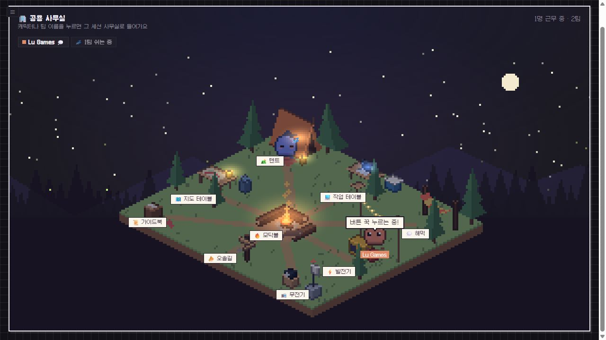
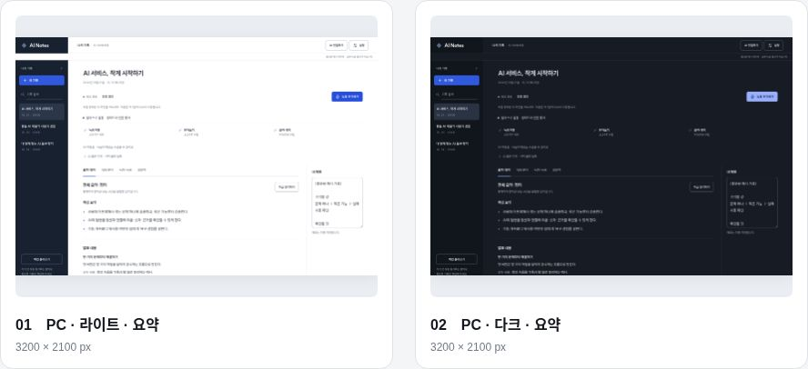

<picture>
  <source media="(prefers-color-scheme: dark)" srcset="assets/banner-dark.svg">
  
</picture>

Java·Spring 기반 백엔드를 개발하고, AI를 활용해 게임과 도구를 만듭니다.

<picture>
  <source media="(prefers-color-scheme: dark)" srcset="https://skillicons.dev/icons?i=java%2Cspring%2Cmysql%2Credis%2Cdocker%2Cgit&amp;theme=dark&amp;perline=6">
  
</picture>

## 백엔드 개발 · Java / Spring

- [SPMIS](https://github.com/dev-Rluan/SPMIS) — 학생 프로젝트 관리 팀 프로젝트. 인증·대시보드 등 담당 기능.

## 게임 개발 · AI 활용

| [touch_down_card_game](https://github.com/dev-Rluan/touch_down_card_game) | [castaways](https://github.com/dev-Rluan/castaways) |
| :--- | :--- |
|  |  |
| 실시간 멀티플레이 카드게임 | 치지직 채팅 참여형 생존 게임 |
| [플레이 ↗](https://touchdown.pebblecraft.io/) | [플레이 ↗](https://island.pebblecraft.io/) |

| [Massive-Consumer](https://rluan0807.itch.io/massive-consumer) | [MapleTactics](https://github.com/MagunMadown/MapleTactics) |
| :--- | :--- |
|  |  |
| 구조물을 흡수하며 성장하는 3D 액션 | 메이플스토리 월드(mLua) 기반 턴제 전술 로그라이크 |
| [플레이테스트 ↗](https://rluan0807.itch.io/massive-consumer) | [플레이 ↗](https://maplestoryworlds.nexon.com/ko/play/d153fb40635e411ea9aa54d2740892a1) |

**MapleTactics · 5인 팀 참여** — 전투 시스템·데이터 검증·설계 문서·몬스터 모델 담당.

## 서비스·도구 개발

- [Pebble Village](https://github.com/dev-Rluan/pebble-village) — Claude Code와 Codex의 작업 상태를 작은 캐릭터들이 일하는 공간으로 보여주는 로컬 대시보드. 픽셀 아트·사무실·캠프 배경과 시간대별 조명 지원.

  

- **ai-notes** — 녹음·받아쓰기·요약을 위한 개인 기록 도구. 소스 비공개.

  

- [growtok](https://rluan.dev/#work) — 어린이집 교사의 보육일지 작성·관리 서비스. 운영 준비 중.

[설계 기록](https://github.com/dev-Rluan/Rluan-s-Payment-system/tree/main/payment-system-portfolio) · [전체 프로젝트](PROJECTS.md)

