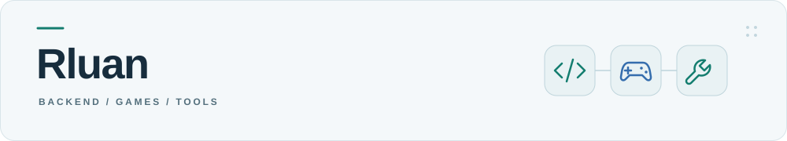
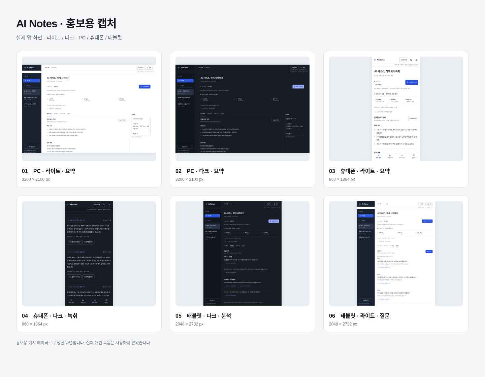

<picture>
  <source media="(prefers-color-scheme: dark)" srcset="assets/banner-dark.svg">
  
</picture>

Java·Spring 기반 백엔드를 개발하고, AI를 활용해 게임과 도구를 만듭니다.

<picture>
  <source media="(prefers-color-scheme: dark)" srcset="https://skillicons.dev/icons?i=java%2Cspring%2Cmysql%2Credis%2Cdocker%2Cgit&amp;theme=dark&amp;perline=6">
  
</picture>

## 백엔드 개발 · Java / Spring

- [SPMIS](https://github.com/dev-Rluan/SPMIS) — 학생 프로젝트 관리 팀 프로젝트. 인증·대시보드 등 담당 기능.

## 게임 개발 · AI 활용

| [touch_down_card_game](https://github.com/dev-Rluan/touch_down_card_game) | [castaways](https://github.com/dev-Rluan/castaways) | [Massive-Consumer](https://rluan0807.itch.io/massive-consumer) |
| :--- | :--- | :--- |
|  |  |  |
| 실시간 멀티플레이 카드게임 | 치지직 채팅 참여형 생존 게임 | 구조물을 흡수하며 성장하는 3D 액션 |
| [플레이 ↗](https://touchdown.pebblecraft.io/) | [플레이 ↗](https://island.pebblecraft.io/) | [플레이테스트 ↗](https://rluan0807.itch.io/massive-consumer) |

## 서비스·도구 개발

- **ai-notes** — 녹음·받아쓰기·요약을 위한 개인 기록 도구. 소스 비공개.

  

- [growtok](https://rluan.dev/#work) — 어린이집 교사의 보육일지 작성·관리 서비스. 운영 준비 중.

[설계 기록](https://github.com/dev-Rluan/Rluan-s-Payment-system/tree/main/payment-system-portfolio) · [전체 프로젝트](PROJECTS.md)

